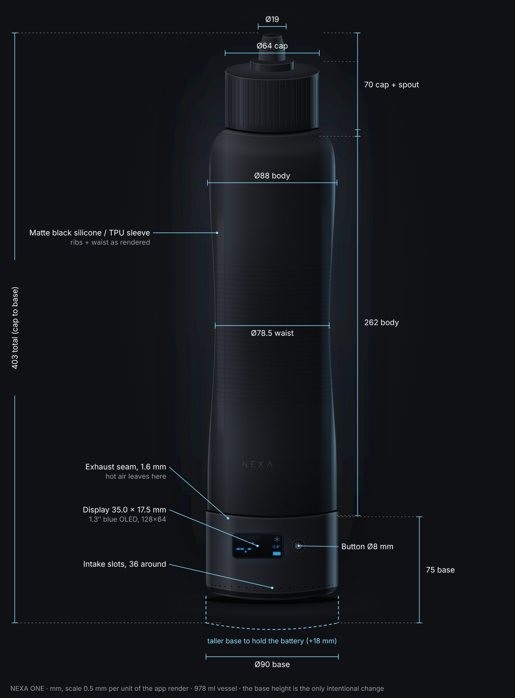

# Build it to look like the app (and work like it)

The bottle in the NEXA ONE app is a render: a black matte ribbed body with a
waist, a sport cap with a spout, and a satin base holding a small blue display
and a round button. This guide turns that picture into real dimensions and a
build plan. [PRINTING-GUIDE.md](PRINTING-GUIDE.md) covers the printed parts, and
[BUILD-GUIDE.md](BUILD-GUIDE.md) covers the electronics, firmware and safety.



> **What the picture doesn't show.** I measured the render and checked whether
> the parts fit inside it:
>
> 1. **The base is too short.** At the scale where it is wide enough, the render's
>    base is 57 mm tall. Four 18650 cells plus the Peltier stack need **75 mm**
>    (the dashed part of the drawing, +18 mm). Everything else is as rendered.
> 2. **The body is very slender.** As rendered it holds about 980 ml and the
>    whole bottle is **403 mm** tall. The practical version shortens the body 20 %.
> 3. **A Peltier under the bottle cools the bottom.** Cold water stays down there
>    and the top stays warm, so the vessel must be **thin aluminium** (BUILD-GUIDE §0).
>
> **A correction to my earlier numbers.** The first version of this guide used a
> Ø86 base. At that size the sleeve would be only about 1 mm thick at the waist
> on a 73 mm bottle, and the cells would have 0.4 mm of room. The design is now
> **scale 0.5 mm per render unit: Ø90 base, Ø78.5 waist**, which fixes both.

## 1. What the app promises, and what the hardware does

| In the app | In the bottle |
|---|---|
| Cooling on / off | Button short press, or the app. The same session is recorded either way |
| Target 5–15 °C, presets 6 / 10 / 14 | Whole-degree thermostat, ±0.2 °C hold band, same numbers |
| Phase: cooling / holding / off | Peltier power follows the gap; a snowflake shows while cooling |
| Battery %, charging, battery saver | 2S pack gauge, USB-C charging, saver = 60 % power |
| History: each cooling run with start/end/min temperature | Recorded in the bottle (16 runs), sent to the app when it reconnects |
| "Bottle display" screen: big temperature, snowflake, target, battery | The real OLED draws that same layout (`drawDisplay()` in the firmware) |
| Guide: hold 3 s, Bluetooth symbol blinks | Exactly that: the OLED shows only a blinking Bluetooth symbol while pairing |

The real bottle is slower than the app's simulator (§2), and the simulator's
tools (fake charger, drain battery) do nothing on real hardware.

## 2. Choose your version

Same diameters and base in both; only the body height differs.

| | **A: Faithful** | **B: Practical (recommended)** |
|---|---|---|
| Body height | as rendered, 262 mm | 80 %, 210 mm |
| Vessel volume (Ø73 bottle) | ≈ 980 ml | ≈ 770 ml |
| Total height with the 75 mm base | **403 mm** | **351 mm** |
| Printer Z height needed (sleeve) | 262 mm | 210 mm |
| Cool-down 24 → 12 °C (base-sized heatsink) | ≈ 1.9 h | ≈ 1.5 h |
| Cool-down 24 → 15 °C | ≈ 1.1 h | ≈ 53 min |
| 24 → 8 °C | not practical (about 5 h or more) | not practical (about 5 h) |

Neither fits a car cup holder (the base is Ø90). With the heatsink that fits in
this base, the bottle is a **keep-it-cold** device: fill it with cold water and
it holds 8–10 °C for hours. Cooling a full bottle from room temperature gets to
about 12–15 °C in an hour or two, not 8 °C. **If you need 15 minutes, read
[COOLING-SPEED.md](COOLING-SPEED.md)**: that needs a much bigger heatsink than a bottle base
can hold. (Times come from the simulation in `design/cooldown_sim.py`, not from a
measurement of your build.)

## 3. Dimensions (scale 0.5 mm per render unit)

| Part | Size (mm) | Notes |
|---|---|---|
| Spout | Ø19 | standard push-pull or bite spout |
| Cap | Ø64 × ≈ 50 | fine vertical grip ribs |
| Body | **Ø88 at the bottom**, Ø85.5 at the shoulder, **Ø78.5 at the waist** | the waist is at mid-body |
| Ribs | 30 rings, 3.2 mm pitch, 0.5 mm deep | from 91 to 188 mm below the top of the body (A) |
| Base | **Ø90 × 75** | the render says 57, see above |
| Display window | 35.0 × 17.5, centred 19.75 mm below the top of the base | 9.75 mm left of the front centre line |
| Button | Ø8.4 ring (8.2 mm hole) | 18 mm right of centre, same height as the display |
| NEXA logo | ≈ 24 mm wide, ≈ 5 mm tall, tone-on-tone | on the body, ≈ 36 mm above the base |
| Intake | 36 slots, 2.4 × 3 mm, 9 mm above the bottom | the render's dotted row |
| Exhaust | 18 slits, 13 × 1.6 mm, at the top seam | the dark line between body and base |
| Sleeve wall | 2.94 mm at the waist, thicker at the ends | on a Ø73 mm bottle |

`design/fit_check.py` recomputes all of this. Change `K` or the vessel diameter
and re-run it.

## 4. The exterior, part by part

**Base, lid, cell cage, sleeve:** printed. Files, settings and assembly are in
[PRINTING-GUIDE.md](PRINTING-GUIDE.md). The sleeve is TPU in the render's exact
outline (read from the render file), with its 30 grip ribs.

**Colours** (taken from the render): body `#1c1e23`–`#30343c`, base satin
`#17191d`–`#2a2e35`, display digits and accents `#35AFFF`. Satin, not gloss, and
no coloured parts apart from the display.

**Vessel.** A thin-wall **aluminium bottle with a food-safe inner coating,
Ø73 mm outside** (about Ø71 inside), flat bottom, standard neck. 73 mm is a common
size. Buy the bottle and put the printed sleeve over it; don't machine it. A
matte black one blends with the sleeve where its shoulder shows. The cap in the
render is narrower than the body (Ø64 on Ø88), so a standard wide-mouth cap
may look a little bigger than the picture.

**Display.** A **1.3″ 128×64 blue OLED** (SH1106, I²C). Its 29.4 × 14.7 mm active
area has the same 2:1 shape as the render's panel. A 1 mm smoked acrylic window
hides the module's frame, so you see a black panel with blue digits, as in the
app. If your module is an SSD1306, change one line in `nexa_one.ino` (marked).

**Button.** 8 mm momentary push button (stainless or black anodised) with a
power symbol engraved on it or on a sticker.

**Logo.** Laser-engrave or UV-print "NEXA" with wide letter-spacing, barely
darker or lighter than the sleeve. It should be hard to see in daylight.

## 5. Inside the base (heights from the bottom, base 75 mm tall)

```
 75  ─ vessel rests on the 4 mm top plate (opening Ø58)
 65–75   aluminium cold block 40×40×10   ← touches the vessel bottom
 61–65   Peltier 40×40×3.9               ← cold side up (test it, BUILD-GUIDE §4)
 41–61   heatsink 40×40×20
 31–41   fan 40×40×10                     ← blows UP through the fins
  3–31   free: board, buck converter, BMS, and the air intake
 3–70    4 × 18650 stand in the cell cage around the stack (N / E / S / W)
  0–3    lid with the fan grille, screwed to 4 bosses
```

Air path: in through the lid grille and the low slots, up past the fan and the
fins, out of the top seam. The seam is also what makes the dark line in the
render.

**Cells:** only flat-top, unprotected **65 mm** 18650s fit: the gap to the top plate
is 0.8 mm. The stack's carrier (the part that holds it 28 mm above the lid) isn't
modelled yet; it depends on your heatsink (PRINTING-GUIDE §5).

## 6. Order of assembly

1. Print the two test pieces and fix the fit (PRINTING-GUIDE §2).
2. Fit the electronics on a bench first (BUILD-GUIDE §6, steps 1–3), then take
   them apart.
3. Mount the display window and the button in the base.
4. Stack: heatsink + fan, then Peltier, then block, with paste.
5. Cell pack in the cage, BMS, fuse, master switch, then the board. Wire per BUILD-GUIDE §3.
6. Close the lid. Check that the fan turns and air comes out of the seam.
7. Seat the vessel in silicone on the top plate, then push the sleeve down over it.
8. Flash the firmware (BUILD-GUIDE §5), then run the checks in BUILD-GUIDE §6.

## 7. What I could not check

- **Nothing has been printed.** The files are watertight and the sizes were
  checked by script, but I haven't built the stack in the base. Expect to adjust
  hole sizes and add mounts (PRINTING-GUIDE §5).
- **The sleeve's inner top** is a plain dome offset 3 mm from the outside; your
  bottle's shoulder may be shaped differently, so a gap there is normal.
- **The display layout** (`drawDisplay()`) compiles against stub libraries, not
  the real U8g2 on a board. The coordinates come from the render and font widths
  may need a small nudge (constants at the top of that block).
- **Cooling times** are arithmetic, not a measurement.
- **Stratification** is why the guide says aluminium. Measure the top and bottom
  temperatures once, and don't trust the display sensor alone.
