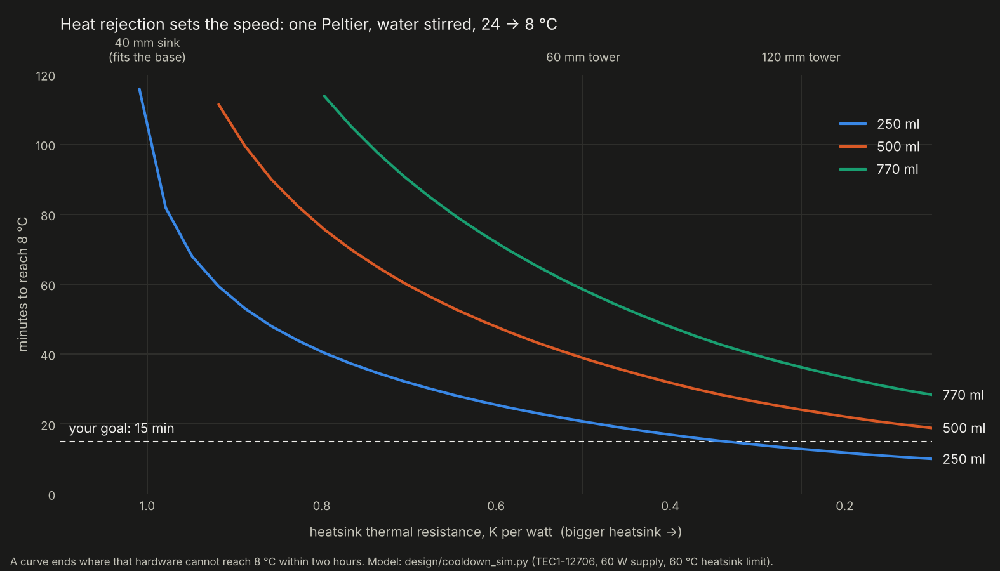

# Cooling in 15 minutes: what is possible

**Short answer:** not with a bottle-sized heatsink, and not for a full bottle.
The fixed amount of heat to remove, and the way a Peltier works, set a floor.
This guide gives the numbers, what each fix costs, and what I recommend.

## 1. Why 15 minutes is hard

Cooling water 24 → 8 °C needs a fixed amount of heat taken out of it. In 15
minutes that is:

| Water | Heat to remove | Average cooling power for 15 min |
|---|---|---|
| 250 ml | 19 kJ | **21 W** |
| 330 ml | 25 kJ | 27 W |
| 500 ml | 36 kJ | **40 W** |
| 770 ml | 54 kJ | **60 W** |
| 980 ml | 68 kJ | 76 W |

One TEC1-12706 pumps up to about 60 W, but only when there is almost no
temperature difference across it. At the end of the cool-down (water 8 °C, hot
side 50 °C+) it pumps about **10 W**, and it burns about 25 W of electricity to
do so. **All of it, 35 W or more, has to leave through the heatsink**, and the
heatsink can't be allowed above about 60 °C. So:

> the heat a heatsink can shed = (60 °C − room temperature) ÷ its thermal resistance

A 40 mm heatsink with a fan is about 1 K/W → about 36 W. That is the whole
budget, however many Peltiers you add. Two modules on the same small heatsink
are actually **slower** (500 ml to 15 °C takes 57 minutes instead of 36): they burn more
power, which the heatsink then has to shed too.

## 2. What each hardware class does

Simulation, 24 °C room, water 24 °C at the start, one TEC1-12706 (two where
stated). The water is **stirred or shaken**: a cold plate at the bottom of a
still bottle cools only the bottom. Stirring makes it about 1.3× faster, and it is what makes
8 °C reachable at all.

**Coldest water the hardware can hold** (it can't go colder however long you wait; below about 4 °C the
model is only a rough guide, and water would start to freeze):

| Heatsink | Stirred | Bottom plate only |
|---|---|---|
| 40 mm sink + fan (fits the base) | 7.8 °C | 9.1 °C |
| 60 mm tower + fan | about 0 °C or colder | about 0 °C or colder |
| 120 mm tower + fan | about 0 °C or colder | about 0 °C or colder |

**Minutes to reach the target** (stirred):

| Heatsink | 250 ml → 8 °C | → 12 °C | → 15 °C | 500 ml → 8 °C | → 12 °C | → 15 °C |
|---|---|---|---|---|---|---|
| 40 mm sink + fan (fits the base) | 100 | 32 | 19 | 188 | 59 | 36 |
| 60 mm tower + fan | 21 | 13 | 9 | 39 | 25 | 17 |
| 120 mm tower + fan | 13 | 9 | 6 | 24 | 16 | 12 |
| 120 mm tower, 2 TECs, 140 W | 10 | 7 | 5 | 19 | 13 | 9 |

**Heatsink needed for 15 minutes to 8 °C** (thermal resistance; smaller means bigger):

| Water | 1 TEC, 60 W supply | 2 TECs, 140 W supply |
|---|---|---|
| 250 ml | 0.34 K/W (about a 90–100 mm tower) | 0.36 K/W |
| 330 ml | 0.20 K/W (a big 120 mm tower) | 0.29 K/W |
| 500 ml | not reachable | **0.18 K/W** (dual heat-pipe tower or a water loop) |
| 770 ml | not reachable | 0.05 K/W (not realistic) |

The full output is in `design/cooldown-results.txt`; `python3 design/cooldown_sim.py` re-runs it.

## 3. What this means for the bottle

With the heatsink that fits the Ø90 base (and the battery), a full bottle cools
to about **15 °C in 40–70 minutes and 12 °C in 1–2 hours**. Cold water poured in
stays at 8–10 °C for hours. That is a good "keep it cold" bottle, not a 15-minute chiller.

I got this wrong before: the earlier guides promised 8 °C in 1–2 hours. They are
corrected now.

## 4. Your options for something close to 15 minutes

| Option | What you get | Cost |
|---|---|---|
| **A. A chill dock (recommended if 15 min matters)** | A plug-in station with a 120 mm tower heatsink and 1–2 Peltiers; the bottle sits on it. **500 ml to 12 °C in 13–16 min, to 8 °C in 19–24 min**; 250 ml to 8 °C in 10–13 min. The bottle keeps its small cooler for holding | A different product: the cold has to pass through the base, or the vessel lifts out onto the dock. 60–140 W from a wall adapter. I can design it |
| **B. A smaller bottle with a bigger base** | 250–330 ml, 60 mm-class heatsink, external power: **250 ml to 12 °C in ≈ 13 min**, to 8 °C in ≈ 21 min | Base about Ø100+; the look changes; no cell ring |
| **C. Lower the target** | With today's base: 250 ml to 15 °C in ≈ 19 min | Free, but it's not cold |
| **D. Start cold** | Use the Peltier to *keep* a bottle cold; fill with fridge-cold water. No waiting at all | Habit |
| **E. Ice assist** | About 4–5 ice cubes (75 g) cool 500 ml by 10 °C in a few minutes, and the Peltier holds it | Not a Peltier solution |

**My recommendation:** build the bottle as designed (it is a good keeper) and,
if you really want the 15 minutes, add **Option A**, the dock. Stirring the
water is the second biggest lever: a stainless cold pin up the middle of the
vessel, or a shaker ball, or simply shaking the bottle once or twice while it
cools.

## 5. What I changed in the code

- **Smoother heatsink limit.** The firmware used to run flat out until the
  heatsink reached 65 °C and then stop dead. It now reduces the Peltier power
  smoothly from 52 °C to zero at 62 °C, so the bottle cools as fast as its
  heatsink allows, and the 65 °C trip is only a last resort. The fan also runs
  whenever the heatsink is above 40 °C. Tested (`firmware/test`, 62 checks pass).
- **The simulation and chart** that this guide is built on
  (`design/cooldown_sim.py`, `design/cooldown_chart.py`).

## 6. How far to trust the numbers

It is a lumped model: water → cold plate → Peltier → heatsink → air. The Peltier
is the standard model fitted to the TEC1-12706 datasheet. I **assumed** the heatsink
resistances (1.0 / 0.5 / 0.25 K/W), the water-side resistances (0.2 stirred /
0.6 still), a 60 °C heatsink limit and a 24 °C room. Real results can easily be
30–50 % different, and a hotter room is slower. **To calibrate it:** clamp your
heatsink and Peltier to a 250 ml cup, time the cool-down, and change
`R_HOT_*`/`r_cold` in `cooldown_sim.py` until the simulation matches. Then the
other rows are trustworthy.
