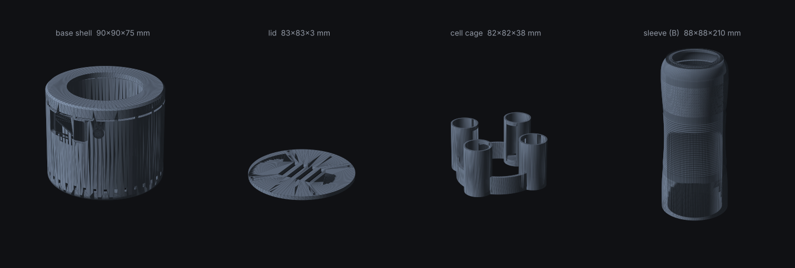

# Printing the NEXA ONE

Everything the app's bottle needs that a printer can make. All files are in
`design/stl/` and are generated by the scripts in `design/`, so you can change
a size and re-make them. The overall look and sizes are in
[APPEARANCE-GUIDE.md](APPEARANCE-GUIDE.md).



> **None of these has been printed yet.** The files are watertight and the sizes
> were checked by script, but the first print is the real test. That is why there
> are two short test pieces: print those first.

## 1. What to print

| Part | File | Material | Needs | Solid volume | Notes |
|---|---|---|---|---|---|
| Test: sleeve ring | `test_sleeve_ring.stl` | TPU 95A | 81 × 81 × 18 mm | 15 cm³ | checks TPU settings and the fit on your bottle |
| Test: base slice | `test_base_slice.stl` | PETG | 90 × 90 × 24 mm | 20 cm³ | checks the wall, slots and that the lid fits |
| Base | `base_shell.stl` | PETG or ASA | 90 × 90 × 75 mm | 70 cm³ | the satin base with display, button, USB-C, vents |
| Lid | `base_lid.stl` | PETG or ASA | 83 × 83 × 3 mm | 15 cm³ | bottom plate with the fan grille, 4 × M3 |
| Cell cage | `cell_cage.stl` | PETG | 82 × 82 × 38 mm | 16 cm³ | holds the 4 × 18650 |
| **Sleeve B** (recommended) | `sleeve_B_210.stl` | **TPU 95A** | 88 × 88 × **210 mm** | 264 cm³ (≈ 320 g solid) | the body, 770 ml bottle |
| Sleeve A (faithful) | `sleeve_A_262.stl` | **TPU 95A** | 88 × 88 × **262 mm** | 330 cm³ (≈ 400 g solid) | the body as rendered, 980 ml bottle |

**Check your build volume first.** Sleeve B needs 210 mm of height and Sleeve A
262 mm. If your printer is shorter, tell me its build volume and I'll split the
sleeve into two rings that join at the waist.

**Don't use PLA for the base:** the heatsink sits right next to it and PLA softens
at about 55 °C. The sleeve needs a flexible filament (TPU 95A): it has to
stretch over the bottle, and a rigid sleeve won't.

## 2. Order

1. **`test_sleeve_ring.stl` in TPU.** Slide it over your aluminium bottle. It
   should be snug but go on by hand. If it is loose or won't go on, open
   `design/sleeve.py` and change `BORE_D` (it is the bottle diameter minus 0.4 mm),
   then run `python3 sleeve.py stl`. Also check that the ribs are visible and
   not stringy.
2. **`test_base_slice.stl` + `base_lid.stl`.** Put the lid in the open end.
   It should drop in with a small gap all round. Check the intake slots are open.
3. Base, lid, cage in PETG/ASA.
4. The sleeve (long print), last.

## 3. Settings

Start from these and adjust to your printer.

| | Base, lid, cage (PETG/ASA) | Sleeve (TPU 95A) |
|---|---|---|
| Nozzle / layer | 0.4 mm / 0.2 mm | 0.4 mm / 0.2 mm |
| Walls | 4 | 3 |
| Top/bottom | 5 layers | 4 layers |
| Infill | 25 % gyroid | 15 % gyroid |
| Speed | 40–50 mm/s | 20–25 mm/s, direct drive recommended |
| Retraction | normal | little or none |
| Temperature | PETG 235–245 °C, ASA 250 °C | per the spool, usually 220–230 °C |
| Cooling fan | PETG 50 %, ASA 0–20 % | 50–100 % |
| Orientation | see below | standing up as modelled |
| Adhesion | brim | brim |

**Base orientation:** flip it so the **top plate is on the bed** and the open end
points up. Then the cavity needs no supports. Turn on supports for the display
window and the USB-C slot (bridging 35 mm is risky), and check the preview. The
1.6 mm exhaust slits and the intake slots are small enough to bridge.

**Lid:** flat on the bed. The four slots in the middle are the fan intake.

**Cell cage:** as modelled, no supports. The slots in the pocket sides print as
short bridges.

**Sleeve:** standing, no supports. Print slowly. Expect a long print: about
**1 day** at TPU speeds. Black is the colour. Don't paint it: TPU already has
the matte, soft look of the render.

**Finishing the base:** sand 400 → 800 on the outside, one coat of filler primer,
sand lightly, then satin black. Leave the inside rough. Mask the slots and the
window before spraying.

## 4. Putting the printed parts together

- **Lid:** 4 × M3 × 8 self-tapping screws into the bosses (the pilot holes are
  2.6 mm). Don't over-tighten; PETG strips.
- **Display:** a 1 mm smoked acrylic window, glued on the flat pad behind the
  window opening. The display module goes behind the pad, held with foam tape.
  The pad is the flat face at 43.4 mm from the centre.
- **Button:** 8 mm panel-mount button through the 8.2 mm hole. If it has a nut,
  add a nut seat first (see §5).
- **Cells:** four flat-top **65 mm unprotected** 18650s, one in each pocket of
  the cage, taped with Kapton. **Protected 69 mm cells won't fit** (the gap to
  the top plate is 0.8 mm). Connect them as 2S2P with nickel strip through the
  slots in the pocket sides.
- **Sleeve → base:** the body is not removable. Spread flexible food-safe
  silicone sealant on the top plate, seat the bottle, then push the sleeve over
  it down onto the base. The silicone also keeps condensation out.

## 5. What is not modelled yet

These depend on the exact parts you buy, so I left them out rather than guess:

- **The Peltier stack carrier.** With a 75 mm base, the cold block has to touch
  the bottle at the top, so the 44 mm stack (block, Peltier, heatsink, fan)
  hangs with its **bottom about 28 mm above the lid**. It needs four legs from the lid
  or posts from the top plate, sized for your heatsink. The 28 mm of free space
  below it is where the board, buck converter and BMS go.
- **Posts for your display module and PCB**, and a nut seat for your button.

When the heatsink, fan, display and board arrive, measure them (length, width,
hole positions) and send me the numbers: I'll add the carrier and mounts to
`base_shell.py`.

## 6. Change a size

Every file has its sizes at the top:

```bash
pip install trimesh manifold3d numpy
cd hardware/design
python3 fit_check.py                  # is it still a design that fits?
python3 base_shell.py stl             # base + lid
python3 cell_cage.py stl
python3 sleeve.py stl                 # sleeves A and B
python3 test_pieces.py stl            # the two test pieces
```

For example, a slightly different bottle: change `VESSEL_OD` and `BORE_D` in
`sleeve.py`. The sleeve wall at the waist must stay above about 2.5 mm
(`fit_check.py` prints it).
